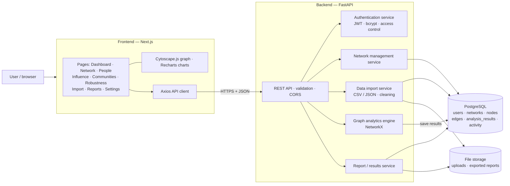

# Structural and Influence Analysis of Social Networks Using Graph Analytics

A full-stack graph analytics platform for studying how a social network is organised. It measures the network's structure, identifies influential and structurally critical people, detects communities, and simulates how the network breaks apart when key members are removed.

You can build or import a network in the browser, explore it as an interactive graph, and read every result in plain language. No code is needed.


> **Full write-up:** [Social_Network_Analytics_Report.pdf](Social_Network_Analytics_Report.pdf) is a 12-page report with annotated screenshots of every page and the findings from a Twitter case study.

---

## Contents
- [The idea](#the-idea)
- [Key findings (Twitter case study)](#key-findings-twitter-case-study)
- [Features](#features)
- [Architecture](#architecture)
- [Project structure](#project-structure)
- [Analytics methods](#analytics-methods)
- [Data model](#data-model)
- [API reference](#api-reference)
- [Getting started](#getting-started)
- [Working with large datasets](#working-with-large-datasets)
- [Testing](#testing)
- [Generating the PDF report](#generating-the-pdf-report)
- [Limitations](#limitations)

---

## The idea

A social network is modelled as a **graph**: people are **nodes** and their relationships (friendships, follows, interactions) are **edges**. Graph analytics then answers four questions:

| Objective | Question | How it is answered |
|---|---|---|
| **Structural analysis** | How dense and connected is the network? Are there clusters or isolated parts? | Density, components, clustering coefficient, transitivity, assortativity, diameter, average path length |
| **Influence identification** | Who matters, and in what way? | Degree, betweenness, closeness, eigenvector and PageRank centrality |
| **Community detection** | Which groups are more tightly connected internally than to everyone else? | Louvain, greedy modularity, label propagation; modularity, density and conductance per group |
| **Comparison and robustness** | Do the measures agree? How fragile is the network? | Rank correlation and top-k overlap between measures; simulated removal of key people |

The central insight is that **having many connections is not the same as being influential.** A person with few connections can still be critical because they are the only link between otherwise separate groups.

> Centrality measures *structural* importance. It does not by itself prove real-world persuasion, popularity or causal influence.

## Key findings (Twitter case study)

The platform was applied to an anonymised **Twitter follower graph of 11.3 million accounts and 85.3 million connections**, analysed through a 2,950-account snowball sample with 100,000 connections. The main results:

- **Popularity ≠ brokerage.** Account `3493` has the most connections (700). Account `8762941` is the strongest bridge, with a betweenness score almost four times higher, and also has the highest PageRank.
- **The measures disagree at the top.** PageRank and eigenvector centrality share *none* of their top-10 accounts, and degree and PageRank share only one. The least-correlated pair is betweenness and eigenvector (Spearman ρ = 0.55).
- **Community structure:**
  - Louvain finds **5 communities** with modularity 0.253, three of them substantial.
  - Community 1 is large and sparse (1,624 people) and organised around a few hubs.
  - Community 2 is tightly knit, with average clustering 0.46.
  - Community 3 is outward-facing: more than half of its links leave the group (conductance 0.56).
- **Robust to random failure, fragile to targeted attack.**
  - Removing accounts in PageRank order fragments the network **1.5× faster** than random removal.
  - After 50% removal, a random attack still leaves a connected core of about 46% of the original network; a PageRank-targeted attack leaves almost nothing.
  - **107 accounts** are single points of failure: each one alone disconnects part of the network.
- **Hub-and-spoke topology.** Degree assortativity is −0.21, average paths are about 2.6 steps, and the estimated diameter is 6.

The four classic benchmark networks are also built in, and Zachary's Karate Club is checked against its real split. On Karate Club, member 33 has the most connections while member 0 is the strongest bridge. Louvain's partition agrees with the club's real split with an adjusted Rand index of 0.49.

## Features

### Frontend pages

| Page | What it does |
|---|---|
| **Dashboard** | Headline metrics, network graph, top influential people, community distribution, generated insights, recent activity. Single points of failure are highlighted in orange. |
| **My Network** | Interactive Cytoscape.js graph with zoom, pan, search highlighting and neighbourhood focus on click. Add, rename or remove people and connections. |
| **People** | Searchable, sortable table of everyone with all five centrality scores. Each person has a profile with ranks, connections and a single-point-of-failure flag. |
| **Influence** | Rankings per metric, Spearman correlation and top-k overlap heatmaps, a scatter plot comparing any two metrics, bridge people, and insights. |
| **Communities** | Algorithms compared by modularity, a community map you can click to focus, community sizes, and per-group statistics (density, conductance, clustering, hub). |
| **Robustness** | Simulations removing people at random or by each metric (optionally recomputed after every step). Charts of the largest connected group and global efficiency, an AUC damage ranking, and a map of articulation points. |
| **Import Data** | CSV upload with column mapping and automatic header detection, JSON upload, a names file to relabel anonymous IDs, one-click research datasets, or building a network by hand. |
| **Reports** | Markdown, CSV and JSON exports, analysis history, and renaming or deleting networks. |
| **Settings** | Profile and account. |

The app also has light and dark mode, follows the system setting by default, and works on mobile screens.


### Backend capabilities
- **Accounts and access control:** JWT authentication with bcrypt-hashed passwords. Each user sees only their own networks.
- **Validation:** no self-connections, no duplicate connections, and connections are undirected (stored once per pair).
- **Data cleaning on import:**
  - drops rows with missing values;
  - removes self-loops;
  - merges duplicate and reversed rows into single weighted edges;
  - reports exactly what it changed.
- **Saved results:** every analysis run is stored, so results load instantly and can be compared over time. A banner warns when a network has changed since it was last analysed.
- **Big-graph handling:**
  - sampled algorithms for very large graphs;
  - a "backbone" graph view in the browser;
  - a streaming sampler for datasets with millions of edges.

## Architecture



**How a request flows:**
1. The user acts in the browser, for example by clicking *Run analysis*.
2. The frontend calls the API with the user's token.
3. The API checks the user owns the network, then loads its nodes and edges from PostgreSQL into a NetworkX graph.
4. The analytics engine computes every metric and saves the results as one analysis record.
5. The frontend draws the updated graph, charts and insights from that saved record.

## Project structure

```
.
├── backend/                      FastAPI application
│   ├── main.py                   App entry point: CORS, routers, table creation
│   ├── config.py                 Settings from environment variables
│   ├── db.py                     SQLAlchemy engine and session
│   ├── models.py                 Database tables (users, networks, nodes, edges, results, activity)
│   ├── schemas.py                Pydantic request and response models (validation)
│   ├── routers/
│   │   ├── auth.py               /api/auth: register, login, profile
│   │   ├── networks.py           /api/networks: CRUD, nodes, edges, import, names, datasets
│   │   └── analytics.py          /api/networks/{id}/analyze, robustness, people, exports, /api/dashboard
│   └── services/
│       ├── auth_service.py       Password hashing, JWT, current-user and ownership checks
│       ├── network_service.py    Node and edge rules, graph loading, bulk inserts
│       ├── import_service.py     CSV/JSON parsing, cleaning, size limits, names files
│       ├── analytics_engine.py   Runs the full analysis and writes the insights
│       └── report_service.py     Markdown / CSV / JSON exports
│
├── sna/                          Graph analysis library (shared by backend, scripts and Streamlit)
│   ├── data.py                   Built-in datasets, edge-list cleaning, graph building
│   └── analysis.py               Metrics, centralities, communities, bridges, robustness, sampled algorithms
│
├── frontend/                     Next.js 15 (App Router, TypeScript, Tailwind CSS)
│   └── src/
│       ├── app/
│       │   ├── login/, register/ Sign-in and sign-up pages
│       │   └── (app)/            Signed-in pages: dashboard, network, people, people/[id],
│       │                         analysis/{influence,communities,robustness}, import, reports, settings
│       ├── components/
│       │   ├── Shell.tsx         Sidebar, top bar, network switcher, theme toggle
│       │   ├── GraphView.tsx     Cytoscape.js graph: backbone view, highlighting, weak points
│       │   ├── Heatmap.tsx       Metric-vs-metric matrix
│       │   ├── NamesUpload.tsx   ID→name relabelling
│       │   ├── AuthForm.tsx      Login and registration form
│       │   └── ui.tsx            Cards, stats, buttons, loading and empty states
│       └── lib/
│           ├── api.ts            Axios client, types, metric labels, colours
│           ├── store.tsx         Auth state and current network / analysis state
│           ├── theme.tsx         Light/dark mode
│           └── useGraph.ts       Loads a graph and maps it to drawable nodes and edges
│
├── tools/
│   ├── sample_large_graph.py     Streams multi-GB edge lists into an analysable sample
│   ├── capture_screenshots.py    Playwright: full-page screenshots of every page
│   └── build_report_pdf.py       Turns project_report.md into a styled A4 PDF
│
├── tests/test_api.py             End-to-end API test
├── run_analysis.py               Batch analysis of the built-in datasets → outputs/
├── app.py                        Original Streamlit prototype
├── outputs/                      Batch results: CSVs, charts, FINDINGS.md
├── report_assets/                Screenshots used in the report and this README
├── project_report.md             Report source
├── Social_Network_Analytics_Report.pdf
├── dev.sh                        Starts PostgreSQL, the API and the web app together
└── requirements.txt              Python dependencies
```

## Analytics methods

All graph computations use **NetworkX** (`sna/analysis.py`).

| Measure | Meaning | Use in this project |
|---|---|---|
| Degree centrality | Share of all others a person is directly connected to | Popularity / reach |
| Betweenness centrality | How often a person lies on the shortest paths between others | Brokers and bridges between groups |
| Closeness centrality | Inverse of average distance to everyone else | Who can spread information fastest |
| Eigenvector centrality | Importance inherited from important neighbours | Embeddedness in the elite core |
| PageRank | Random-walk importance (the method behind Google's original ranking) | Overall influence; node size in the graphs |
| Clustering coefficient | How many of a person's friends know each other | Tight-knit vs. star-like neighbourhoods |
| Modularity (Q) | Share of edges inside communities minus the share expected by chance | Quality of a community partition |
| Conductance | Share of a group's links that leave the group | How self-contained a community is |
| Participation coefficient | How evenly a person's links spread across communities | Identifying bridge people |
| Articulation points | Nodes whose removal disconnects the graph | Single points of failure |
| Robustness AUC | Area under the largest-component curve during removal | Damage of each removal strategy (lower = more damaging) |

Rankings are compared with **Spearman rank correlation** and **top-k overlap**. Communities on the Karate Club network are checked against the real club split using the **adjusted Rand index**.

**Scaling.** When `nodes × edges` exceeds 2×10⁷, exact all-pairs computations are too slow, so the engine estimates them instead:
- **Betweenness:** computed from a random sample of starting nodes (pivots).
- **Closeness:** estimated from breadth-first-search distances to 300 sampled pivots. On a benchmark network the estimate ranked people almost the same as the exact calculation (Spearman ρ = 0.987).
- **Diameter and average path length:** estimated from pivots with a double-sweep bound.
- **Greedy modularity:** skipped above 5,000 people or 50,000 edges.

With these, analysis of a 3,000-person, 100,000-edge network takes about 40 seconds, down from 222 seconds.

## Data model

| Table | Key columns | Notes |
|---|---|---|
| `users` | id, email (unique), name, password_hash, preferences | bcrypt hashes; email is the login |
| `networks` | id, user_id, name, description, created_at, updated_at | `updated_at` drives the "analysis out of date" warning |
| `nodes` | id, network_id, label, attributes (JSON) | `label` is unique within a network; `attributes.source_id` keeps the original ID after renaming |
| `edges` | id, network_id, source_id, target_id, weight | Undirected: always stored with `source_id < target_id`; unique per pair |
| `analysis_results` | id, network_id, created_at, summary, metrics, communities, comparison, robustness, insights | One saved record per analysis run |
| `activity` | id, user_id, network_id, message, created_at | Feeds "Recent activity" on the dashboard |

## API reference

Interactive documentation is available at `http://localhost:8000/docs` once the API is running. Every endpoint except register, login, health and datasets needs an `Authorization: Bearer <token>` header.

| Method | Endpoint | Purpose |
|---|---|---|
| POST | `/api/auth/register` · `/api/auth/login` | Create an account / sign in (returns a JWT) |
| GET / PATCH | `/api/auth/me` | Current user, update profile |
| GET / POST | `/api/networks` | List / create networks |
| POST | `/api/networks/sample` | Create a network from a built-in dataset |
| GET / PATCH / DELETE | `/api/networks/{id}` | Read / rename / delete a network |
| GET | `/api/networks/{id}/graph` | All nodes and edges |
| POST · PATCH · DELETE | `/api/networks/{id}/nodes[/{node_id}]` | Add / edit / remove a person |
| POST · DELETE | `/api/networks/{id}/edges[/{edge_id}]` | Add / remove a connection |
| POST | `/api/networks/{id}/import` | Upload CSV/JSON (`file`, optional `source`, `target`, `weight`) |
| POST | `/api/networks/{id}/names` | Upload an `id,name[,extra…]` file to label people |
| POST | `/api/networks/{id}/analyze` | Run the full analysis and save it |
| GET | `/api/networks/{id}/analysis` · `/analysis/latest` | Analysis history / latest result |
| POST | `/api/networks/{id}/robustness` | Custom robustness simulation |
| GET | `/api/networks/{id}/people/{node_id}` | One person's metrics and connections |
| GET | `/api/networks/{id}/reports/export?format=md\|csv\|json` | Download results |
| GET | `/api/dashboard` · `/api/datasets` · `/api/health` | Dashboard totals, built-in datasets, health check |

## Getting started

### Prerequisites
- Python 3.11+
- Node.js 20+
- PostgreSQL 14+ (`initdb`, `pg_ctl` and `createdb` on your PATH)

### One command
```bash
./dev.sh
```
This does the following:
1. Creates a project-local PostgreSQL cluster in `.pgdata/` on port **5433** (your system PostgreSQL is not touched).
2. Installs the Python and npm dependencies on the first run.
3. Starts the API on **:8000** and the web app on **:3000**.

Then open <http://localhost:3000>, register an account, and load a dataset from **Import Data**.

### Manual setup
```bash
python3 -m venv .venv && .venv/bin/pip install -r requirements.txt
.venv/bin/uvicorn backend.main:app --reload --port 8000        # from the project root

cd frontend && npm install && npm run dev                       # http://localhost:3000
```

### Configuration (environment variables)

| Variable | Default | Purpose |
|---|---|---|
| `DATABASE_URL` | `postgresql+psycopg://sna@localhost:5433/sna` | Database connection |
| `JWT_SECRET` | development value | **Set a long random value in production** |
| `JWT_EXPIRE_MINUTES` | `1440` | Token lifetime |
| `CORS_ORIGINS` / `CORS_ORIGIN_REGEX` | any `localhost` port | Allowed frontend origins |
| `STORAGE_DIR` | `./storage` | Uploaded datasets and exported reports |
| `NEXT_PUBLIC_API_URL` (frontend) | `http://localhost:8000` | Where the frontend finds the API |
| `NEXT_DIST_DIR` (frontend) | `.next` | Build folder; give a second dev server its own folder |

### Built-in datasets
Zachary's Karate Club (with the real club split), Les Misérables co-appearances, Florentine family marriages, and Davis Southern Women. To add SNAP's Facebook ego networks, put `facebook_combined.txt` in `data/`.

## Working with large datasets

The web app analyses networks of up to **20,000 people and 150,000 connections**, with uploads up to 50 MB. For anything bigger, extract a representative sample first. The sampler streams the file, so memory use stays flat, and it processes the 1.3 GB Twitter file in about 30 seconds:

```bash
.venv/bin/python tools/sample_large_graph.py edges.csv                        # snowball sample, ~3,000 people
.venv/bin/python tools/sample_large_graph.py edges.csv --method top-degree --people 1000
```

- **Snowball** (default) starts from a few ordinary accounts and grows outward, preserving communities and bridges.
- **Top-degree** keeps the most-connected core.

Headerless files (e.g. `1,11553`) are detected automatically. A one-column node-ID file isn't needed when every person appears in the edge list.

When data has only numeric IDs, upload a names file on **Import Data → Add names to people**. Extra columns become profile fields.

In the browser, graphs with more than 300 people or 3,000 connections are drawn as a **backbone**: the most influential people plus every single point of failure, with the strongest connections between them. Tables, search and all metrics still cover everyone.

## Testing

```bash
.venv/bin/python -m pytest tests -q                 # end-to-end API test (needs PostgreSQL running)
cd frontend && npx tsc --noEmit && npx eslint src   # type-check and lint
```

`tests/test_api.py` exercises:
- registration and login, and access control between users;
- adding and removing people and connections, including validation errors;
- CSV import with dirty rows, headerless files, node lists, JSON import, and oversized files;
- names files, analysis, profiles, all three export formats, and robustness.

## Generating the PDF report

With the API and web app running:

```bash
.venv/bin/python -m playwright install chromium     # once
SNA_EMAIL=you@example.com SNA_PASSWORD=... .venv/bin/python tools/capture_screenshots.py \
    --base http://localhost:3000 --network "twitter sample"
.venv/bin/python tools/build_report_pdf.py          # project_report.md → Social_Network_Analytics_Report.pdf
```

To regenerate the figures and `outputs/FINDINGS.md` for the built-in datasets, run `.venv/bin/python run_analysis.py`.

## Limitations

- **Sampling:** results on the Twitter data describe a 2,950-account snowball sample, not all 11.3 million accounts, and snowball sampling over-represents well-connected regions.
- **Approximation:** on large graphs, betweenness, closeness, diameter and path length are estimated rather than computed exactly.
- **Anonymity:** Twitter accounts are anonymous numeric IDs.
- **Interpretation:** centrality reflects structural position, not proven real-world influence.

**Possible extensions:**
- temporal analysis for timestamped data;
- a graph database such as Neo4j for traversal queries;
- containerised background workers and object storage for full-scale graphs.

## Tech stack

**Frontend:** Next.js 15, React 19, TypeScript, Tailwind CSS 4, Cytoscape.js, Recharts, Axios, lucide-react
**Backend:** Python 3.13, FastAPI, Pydantic, SQLAlchemy 2, PyJWT, bcrypt, NetworkX, pandas, NumPy, SciPy
**Database:** PostgreSQL 16
**Tooling:** pytest, Playwright, Streamlit (prototype), Matplotlib/Plotly (batch figures)
