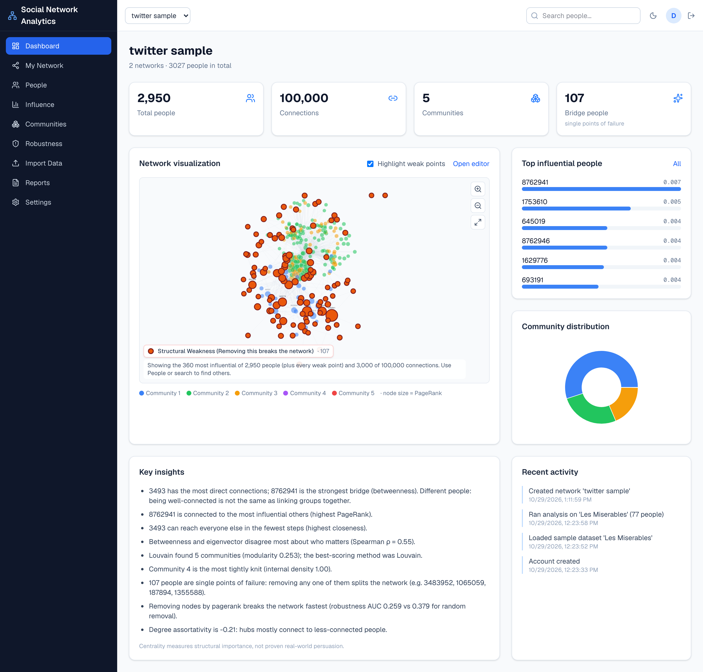
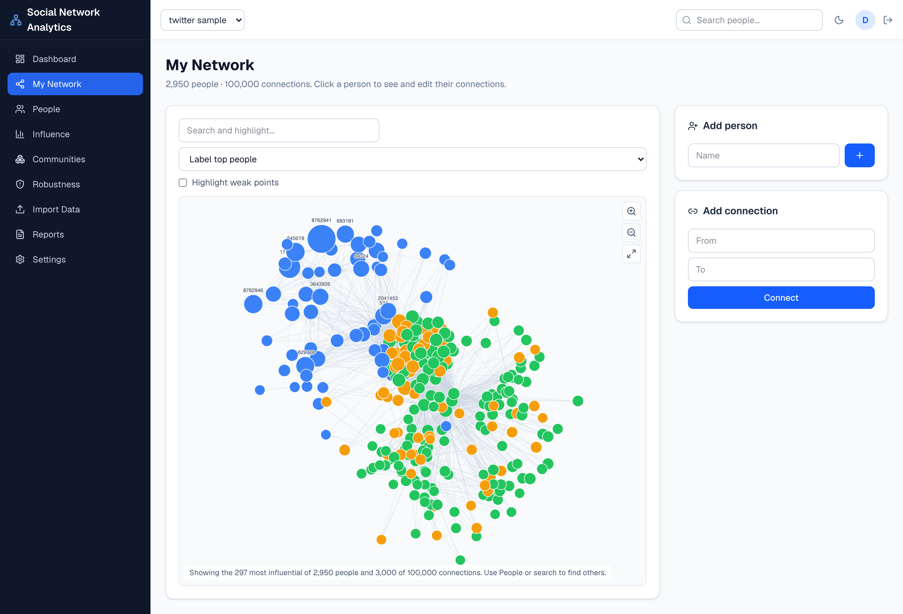
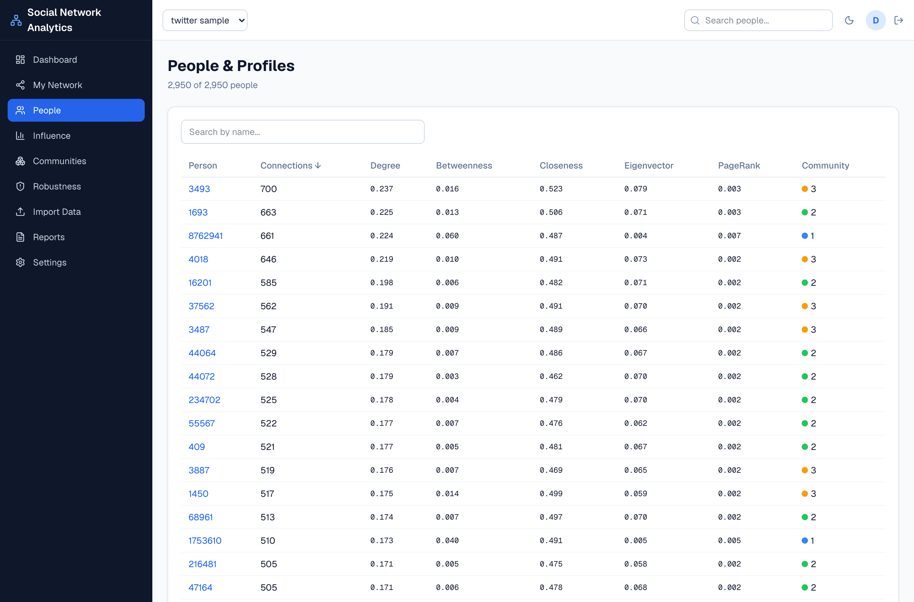
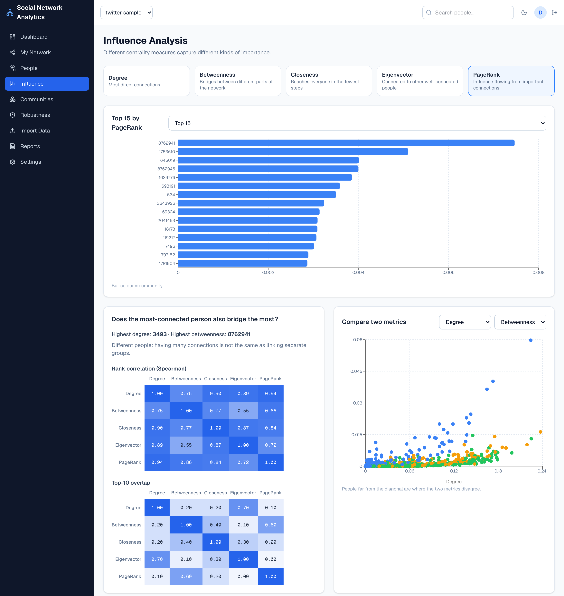
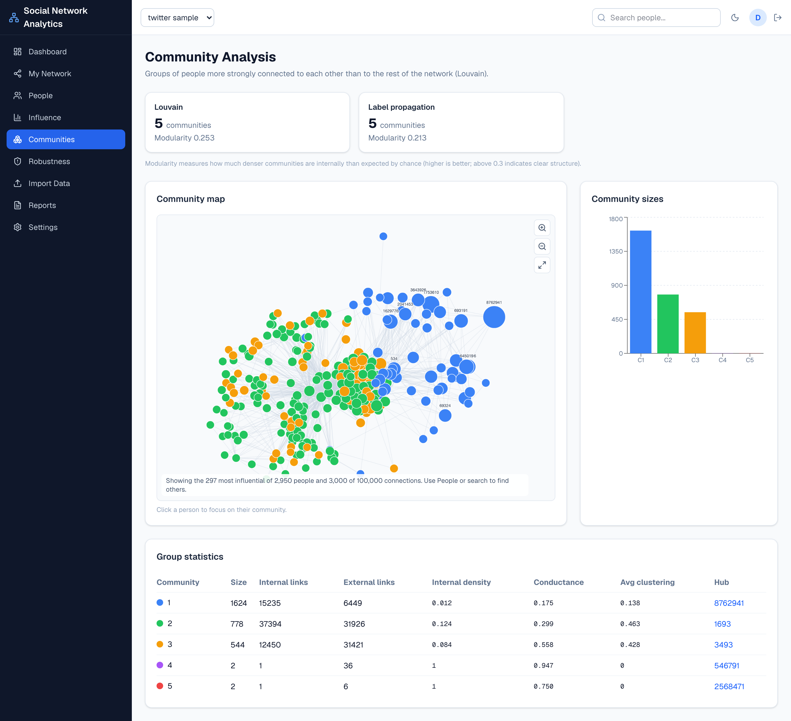
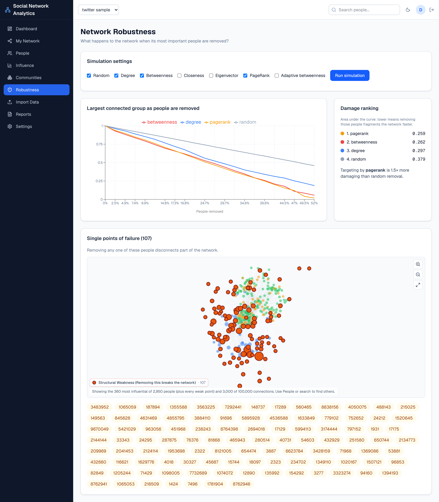
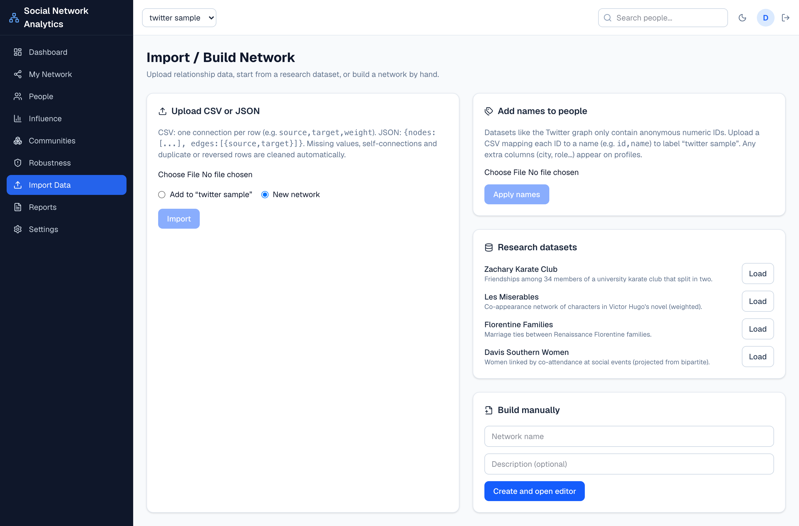
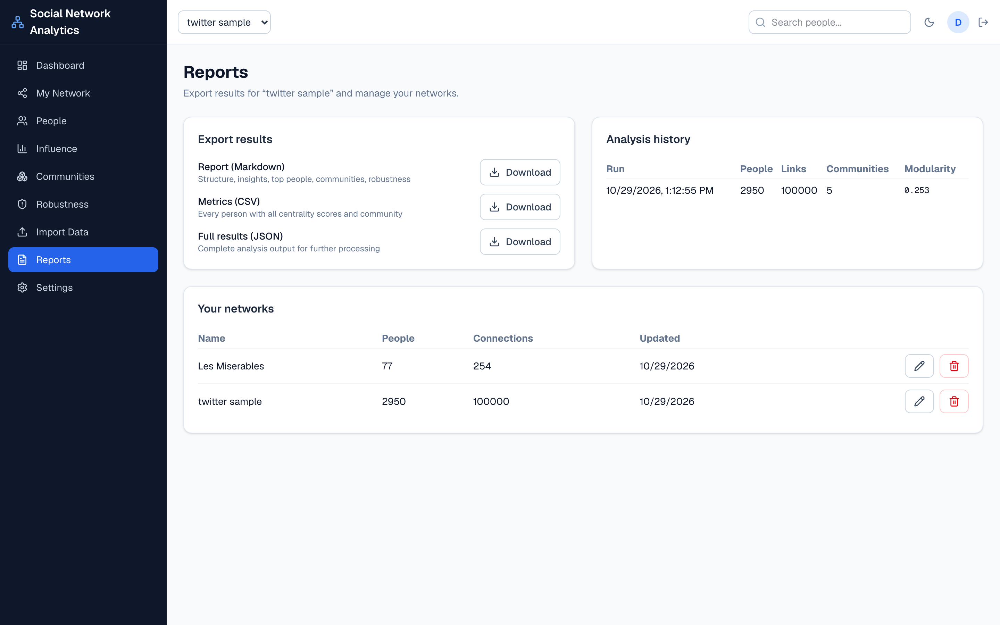

Project Report

<h1>Structural and Influence Analysis of Social Networks Using Graph Analytics</h1>

A full-stack platform for measuring network structure, identifying influential and structurally critical individuals, detecting communities and stress-testing network robustness, applied to a sample of the Twitter follower graph.

<table class="facts">
<tr><td>Frontend</td><td>Next.js 15 · TypeScript · Tailwind CSS · Cytoscape.js · Recharts</td></tr>
<tr><td>Backend</td><td>Python · FastAPI · SQLAlchemy · NetworkX · pandas</td></tr>
<tr><td>Database</td><td>PostgreSQL</td></tr>
<tr><td>Case-study data</td><td>Twitter follower graph (11.3 million accounts, 85.3 million connections), analysed through a 2,950-account sample</td></tr>
</table>

## 1. Introduction and objectives

Social networks can be modelled as graphs, in which **nodes** represent individuals or accounts and **edges** represent the relationships between them. Treating a network this way makes it possible to answer questions that simple counts cannot: who holds a group together, which accounts sit between otherwise separate groups, and how fragile the whole structure is.

The project was built around four objectives:

1. **Structural analysis:** measure how dense, clustered and connected the network is.
2. **Influence identification:** rank individuals with five complementary centrality measures (degree, betweenness, closeness, eigenvector and PageRank).
3. **Community detection:** find groups that are more densely connected internally than to the rest of the network, using Louvain, greedy modularity and label propagation.
4. **Comparative and robustness analytics:** test whether the measures agree on who matters, and simulate how quickly the network fragments when its most important members are removed.

The central finding is that **being highly connected is not the same as being structurally influential**. The account with the most connections is not the account that bridges the network, and the measures disagree substantially about who matters. Throughout, centrality is interpreted as *structural* importance; it does not by itself prove real-world persuasion or causal influence.

## 2. System architecture

The platform follows a three-tier architecture. A **Next.js** single-page application provides the user interface. It talks over HTTPS and JSON to a **FastAPI** backend, which is organised into the following services:

- **Authentication:** bcrypt password hashing, JWT tokens and per-user access control.
- **Network management:** creating and validating nodes and edges.
- **Data import:** CSV and JSON parsing, cleaning and de-duplication.
- **Graph analytics engine:** built on NetworkX.
- **Report generation:** Markdown, CSV and JSON exports.

Users, networks, nodes, edges, analysis results and an activity log are stored in **PostgreSQL**. Each analysis run is saved, so results can be revisited and compared without being recomputed.

To keep the interface responsive on large graphs, the engine switches from exact to sampled algorithms above a fixed computational budget:

- **Betweenness:** computed from a random sample of starting nodes (pivots).
- **Closeness:** estimated from breadth-first-search distances to sampled pivots.
- **Diameter and average path length:** estimated from sampled pivots with a double-sweep bound.

The browser likewise draws a "backbone" view of the most influential members rather than every edge.

## 3. Dataset and methodology

The case study uses an anonymised Twitter follower graph containing **11,316,811 accounts and 85,331,845 connections** (1.3 GB). A graph of this size cannot be analysed interactively, so a purpose-built streaming sampler (`tools/sample_large_graph.py`) extracted a representative sample:

- **Snowball sampling:** starting from five seed accounts of ordinary activity, the sampler repeatedly added a capped number of each account's neighbours until **2,950 accounts** were reached.
- **Induced connections:** it then kept the connections among those accounts, randomly capped at **100,000**.

Snowball sampling preserves local structure such as communities and bridges, which is what the analysis studies. However, results describe the sample rather than the full Twitter graph. Account identifiers are anonymised numeric IDs, so individuals are referred to by ID.

## 4. Application walkthrough and findings

### 4.1 Dashboard

The dashboard is the executive overview of the selected network. Four headline indicators summarise its scale:

- **2,950** people
- **100,000** connections
- **5** communities
- **107** single points of failure (bridge people)

The interactive Cytoscape.js visualisation colours each node by community and sizes it by **PageRank**, a recursive measure in which a node is important if it is connected to other important nodes. Structural weaknesses are overlaid in orange: these are *articulation points*, nodes whose removal disconnects the graph. The side panels rank the most influential accounts (led by **8762941**, PageRank 0.007) and show the community distribution, in which three communities hold almost all members.

The automatically generated insights state the project's key result directly. Account **3493** has the most direct connections, but account **8762941** is the strongest bridge by betweenness centrality, showing that popularity and brokerage are distinct roles. A degree assortativity of **−0.21** indicates a hub-and-spoke pattern: highly connected accounts tend to link to less-connected ones rather than to each other, which is typical of follower networks.

### 4.2 My Network: interactive graph editor

The *My Network* page is the working canvas for exploring and editing the graph. Users can:

- **Explore:** zoom, pan, search to highlight matching accounts, and click any node to isolate its immediate neighbourhood (its *ego network*).
- **Edit:** rename or remove people, and add or remove connections.

Every edit is validated server-side: self-loops and duplicate edges are rejected and the graph is kept undirected. Any analysis results that the change makes out of date are flagged so they can be re-run.

The layout uses a force-directed algorithm (CoSE), which places tightly interlinked nodes close together, so community structure becomes visible without being imposed. On this 2,950-account network the canvas deliberately renders a backbone of the **297 most influential accounts and 3,000 strongest connections**. The full 100,000-edge graph would freeze a browser, while the backbone keeps the dominant structure legible.

The picture that emerges is two regions. One is a dense core where the green and orange communities interpenetrate. The other is a looser blue region organised around a few large hubs (8762941, 1753610, 693191, 645019), linked to the core through a small number of bridging accounts.

### 4.3 People and profiles

The *People* page is a searchable, sortable register of every account, showing its number of connections, all five centrality scores and its community. Placing the measures side by side shows how differently they rank the same individuals:

- **Account 3493** tops degree (700 connections, normalised degree 0.237) and closeness (0.523), so it can reach the rest of the network in the fewest steps.
- **Account 8762941** has fewer connections (661) but a betweenness score of **0.060**, almost four times that of 3493 (0.016), together with the highest PageRank in the network.
- **Account 1753610** illustrates the same pattern even more sharply. With only 510 connections it ranks second in betweenness (0.040), because its links span communities rather than accumulating inside one.

Each name links to a profile page that translates these scores into plain language, with ranks out of 2,950, and flags whether the account is a single point of failure.

### 4.4 Influence analysis

The *Influence Analysis* page compares the five centrality measures, each answering a different question:

| Measure | Question it answers |
|---|---|
| **Degree** | Who has the most direct connections? |
| **Betweenness** | Who lies on the shortest paths between others, brokering between groups? |
| **Closeness** | Who can reach everyone in the fewest steps? |
| **Eigenvector** | Who is connected to other well-connected people? |
| **PageRank** | Who receives influence flowing through important connections? |

The *Spearman rank-correlation* heatmap shows that most measures agree broadly (degree vs PageRank ρ = 0.94, degree vs closeness ρ = 0.90). However, **betweenness and eigenvector centrality disagree most (ρ = 0.55)**: brokers between communities are rarely the best-connected members within a dense cluster.

The *top-10 overlap* matrix makes the disagreement concrete at the top of the ranking:

- **PageRank and eigenvector share none** of their top ten accounts (overlap 0.00).
- **Degree and PageRank share only one** (0.10).

The scatter plot of degree against betweenness shows that a handful of accounts sit far above the trend line. These are the bridge accounts listed below the chart, several of which touch three or four communities.

### 4.5 Community analysis

Community detection partitions the network into groups that are denser internally than expected by chance. Partition quality is measured by **modularity (Q)**, the fraction of edges inside communities minus the fraction expected in a random graph with the same degrees. Two algorithms are compared:

- **Louvain:** 5 communities, Q = 0.253 (the best partition).
- **Label propagation:** 5 communities, Q = 0.213.

Greedy modularity is also implemented but is skipped automatically on graphs of this size for performance.

A modularity of 0.25 indicates real but overlapping community structure, consistent with the interpenetrating clusters seen on the map. The group statistics reveal three very different communities:

| Community | Size | Character | Internal density | Avg clustering | Conductance | Hub |
|---|---|---|---|---|---|---|
| 1 | 1,624 | Large and sparse, organised around hubs rather than mutual ties | 0.012 | 0.138 | 0.175 (most self-contained) | 8762941 |
| 2 | 778 | Tightly knit | 0.124 | 0.463 | 0.299 | 1693 |
| 3 | 544 | Strongly outward-facing | 0.084 | 0.428 | 0.558 | 3493 |

Communities 2 and 3 have high clustering, meaning many friend-of-a-friend triangles. Community 3's conductance of 0.558 means more than half of its links leave the group. Communities 4 and 5 contain only two accounts each, so their perfect internal density (1.0) is a statistical artefact of size rather than a meaningful finding.

### 4.6 Network robustness

The robustness module simulates removing up to half of the network and tracks the size of the **largest connected component** after each step. Members are removed either at random or in order of a centrality measure, and damage is summarised as the **area under the curve (AUC)**, where lower means faster fragmentation. The results show the classic asymmetry of real-world networks: *robust to random failure, fragile to targeted attack*.

| Removal strategy | AUC (lower = more damaging) |
|---|---|
| PageRank | **0.259** |
| Betweenness | 0.262 |
| Degree | 0.297 |
| Random | 0.379 |

The divergence is starkest at 50% removal:

- **Random removal** still leaves a connected core of roughly **46%** of the original network.
- **Removal by PageRank or betweenness** collapses it to almost nothing.

Targeting by PageRank is therefore about **1.5 times more damaging** than random removal.

The lower panel shows the **107 single points of failure** (articulation points) in orange. Each one alone holds part of the network together, typically by being the only link to a peripheral group. These are the accounts whose loss would most directly fragment communication, and the obvious candidates for monitoring or redundancy in an operational setting.

### 4.7 Data import and network building

The *Import / Build Network* page makes the platform usable on new data without technical knowledge. It offers four ways in:

- **CSV and JSON edge lists**, with column mapping and automatic header detection. During import the cleaning layer drops missing values and self-connections, and merges duplicate or reversed edges into single undirected weighted edges. It then reports exactly what it changed.
- **Names file:** a separate upload attaches readable names (and extra profile attributes) to anonymous IDs, relabelling stored results without re-running analysis.
- **Research datasets:** four benchmark networks load with one click (Zachary Karate Club, Les Misérables, Florentine Families and Davis Southern Women).
- **Manual building:** a network can be built from scratch in the editor.

Uploads are limited to 50 MB, and analysis to 20,000 people and 150,000 connections. Larger datasets such as the full Twitter graph are routed through the streaming sampler described in Section 3.

### 4.8 Reports and analysis history

The *Reports* page closes the analytical loop. Each analysis run is stored with its timestamp, network size, community count and modularity, giving an auditable history that supports before-and-after comparison as a network is edited or re-imported. Results can be exported in three formats:

- **Markdown report:** structure, generated insights, top-ranked people, community profiles and robustness scores.
- **CSV metrics table:** every person with all centrality scores and their community assignment.
- **JSON file:** the complete analysis output for further processing.

Users can also rename or delete networks. Data is isolated per account, so each user sees only their own networks.

## 5. Conclusions

1. **Influence is multi-dimensional.** The most-connected account (3493) and the strongest bridge (8762941) are different people, and the top-ten lists of PageRank and eigenvector centrality do not overlap at all. Choosing a single "influence" metric would give a misleading picture.
2. **The sampled Twitter network has a hub-and-spoke, community-structured topology.** It shows negative degree assortativity (−0.21), short paths (an estimated average of 2.6 steps and diameter of 6), and moderate modularity (0.25) across three substantive communities.
3. **The network is robust to random failure but fragile to targeted removal.** Removing accounts by PageRank or betweenness fragments it about 1.5 times faster than random removal, and 107 individual accounts are single points of failure.

## 6. Limitations and future work

- **Sampling:** results describe a 2,950-account snowball sample, with connections randomly capped at 100,000, not the full 11.3-million-account graph. Snowball sampling over-represents well-connected regions.
- **Approximation:** above a computational budget, betweenness, closeness, diameter and average path length are estimated from sampled pivots rather than computed exactly. On a benchmark network the approximate closeness ranking correlated with the exact ranking at ρ = 0.987.
- **Anonymity and interpretation:** accounts are anonymous numeric IDs, and centrality measures structural position only, not persuasion or real-world influence.
- **Future work:**
    - Temporal analysis, when timestamped data is available.
    - A native graph database (for example Neo4j) for traversal queries.
    - Containerised, cloud-hosted background processing for full-scale graphs.
